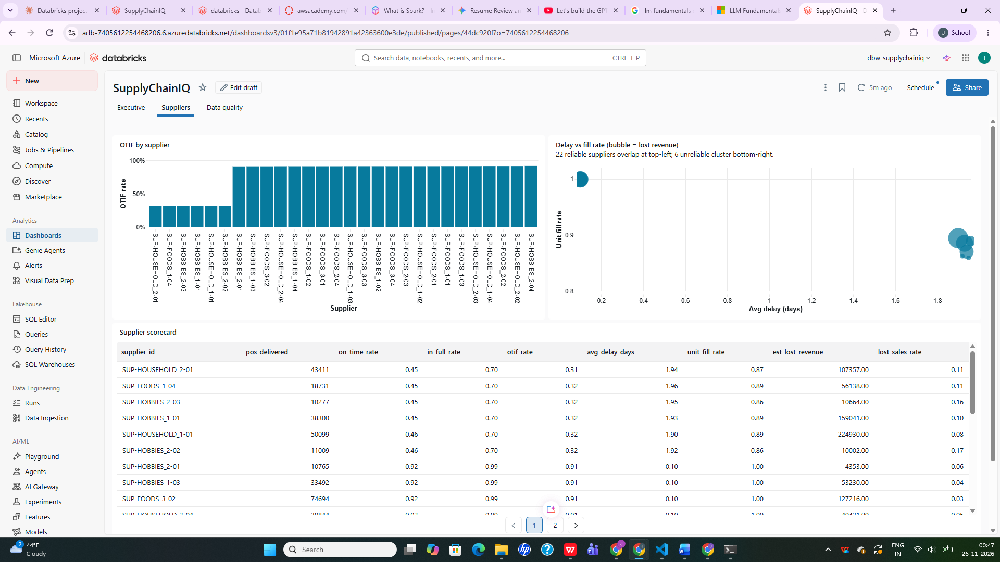
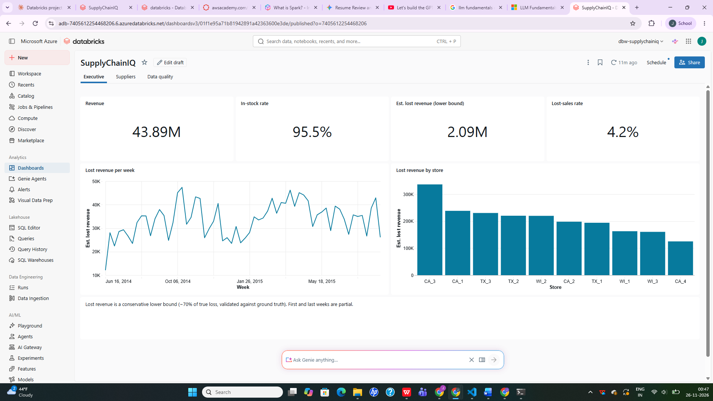
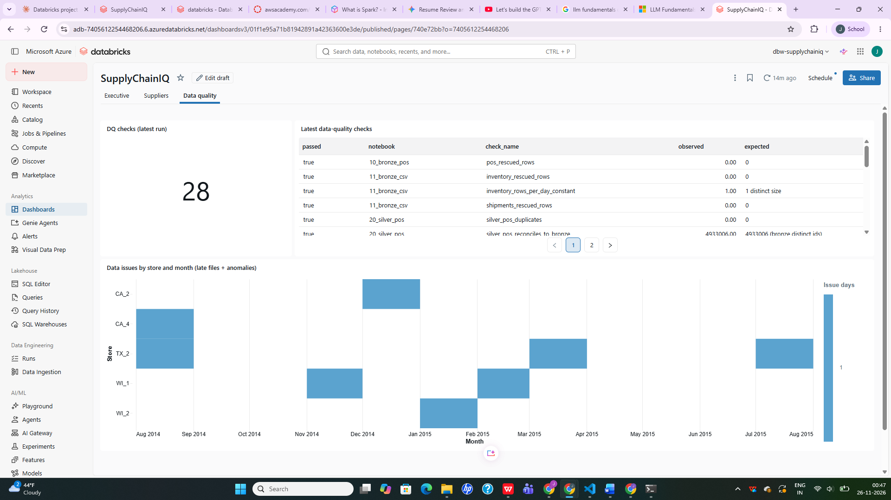
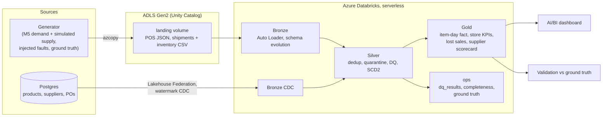

# SupplyChainIQ

Production-style lakehouse on **Azure Databricks** that answers: *which suppliers cause stockouts, and how much revenue do we lose?*

Real Walmart demand (M5) drives a simulated supply chain (suppliers, purchase orders, shipments, inventory)
with **injected faults and a ground-truth table**, so every data-quality rule and estimate is graded, not assumed.

## Results so far
| Area | Result (graded against ground truth) |
|---|---|
| Bronze ingestion (Auto Loader) | Incremental + exactly-once; schema drift (`carrier_code`) evolved automatically |
| POS deduplication | 14,765 / 14,765 injected duplicates removed, 0 remaining |
| Inventory DQ | 31 / 31 bad rows quarantined, 0 false alarms |
| Completeness monitor | 7 / 7 late files caught; holidays separated; 1 real Walmart store anomaly surfaced |
| Postgres CDC (query-based) + SCD2 | Silver POs = source (1,059,859); received POs = shipment files exactly |
| Supplier scorecard | Unreliable suppliers found blind: OTIF 0.31 vs 0.91; 3x lost-sales rate |
| Lost-sales estimate (censored demand) | EM estimator captures ~70% of true loss (WAPE 0.30); reported as a lower bound |
| Demand forecast (LightGBM + MLflow) | 28-day direct forecast on censoring-corrected demand, graded vs true demand: item-day WAPE 0.845 vs 0.834 for a 28-day moving average, so the champion/challenger gate did **not** promote it (see ADR 0002) |

## Dashboard (Databricks AI/BI)




## Architecture


**Orchestration:** a daily Lakeflow Job (`supplychainiq_daily`, 10 tasks, serverless) and a weekly training job
(`supplychainiq_forecast_weekly`). The daily job has retries, timeouts, failure email
and data-quality assertions that fail the run (`ops.dq_results`).
**Deployment:** the job is defined as code in a Databricks Asset Bundle (`databricks.yml`, `resources/`) with `dev` and
`prod` targets; GitHub Actions lints, tests and validates every push and deploys to prod from `main`.

## Roadmap
- [x] Generator, fault injection, ground truth (local, tested, CI)
- [x] Azure + Unity Catalog setup; Bronze; Silver + DQ; Gold; Postgres CDC + SCD2
- [x] Lakeflow Job orchestration + alerts
- [x] AI/BI dashboard
- [ ] Declarative pipeline (incremental)
- [x] Asset Bundles + CI/CD (dev/prod)
- [x] Demand forecast + MLflow (champion/challenger gate in Unity Catalog)

## Design decisions
| ADR | Decision |
|---|---|
| [0001](docs/adr/0001-azure-databricks.md) | Azure Databricks, serverless only, Unity Catalog |
| [0002](docs/adr/0002-one-model-rule-based-stockout.md) | One demand forecast; stockout risk as a rule on it |
| [0003](docs/adr/0003-generator-assumptions.md) | Real demand + simulated supply, graded against ground truth |
| [0004](docs/adr/0004-query-based-cdc.md) | Query-based watermark CDC via Lakehouse Federation |
| [0005](docs/adr/0005-censored-demand-lower-bound.md) | Lost sales from censored demand, reported as a lower bound |

## Repo layout
- `src/supplychainiq/generator/`: simulation + fault injection (tested)
- `notebooks/databricks/`: Bronze, Silver, Gold, CDC, forecast (`50_forecast_train`) and validation notebooks (`_common` holds shared config + DQ helpers)
- `databricks.yml`, `resources/`: Asset Bundle (job definition, dev/prod targets)
- `.github/workflows/ci.yml`: lint, tests, bundle validate, deploy to prod on `main`
- `scripts/`: data download, landing upload, Postgres replay
- `docs/`: ADRs, tuning log, data profile, dashboard screenshots

## Local setup
```bash
python -m venv .venv && source .venv/bin/activate   # Windows: .venv\Scripts\activate
pip install -r requirements-dev.txt
bash scripts/download_data.sh
pytest -q && ruff check .
```

## Deploy
```bash
databricks auth login --host <workspace-url>
databricks bundle validate -t prod
databricks bundle deploy -t prod
databricks bundle run -t prod supplychainiq_daily
```
`-t dev` deploys a per-user copy (`[dev <user>]` prefix, schedule paused) against the `supplychainiq_dev` catalog.
CI does the prod deploy automatically on every push to `main` (secrets: `DATABRICKS_HOST`, `DATABRICKS_TOKEN`).
